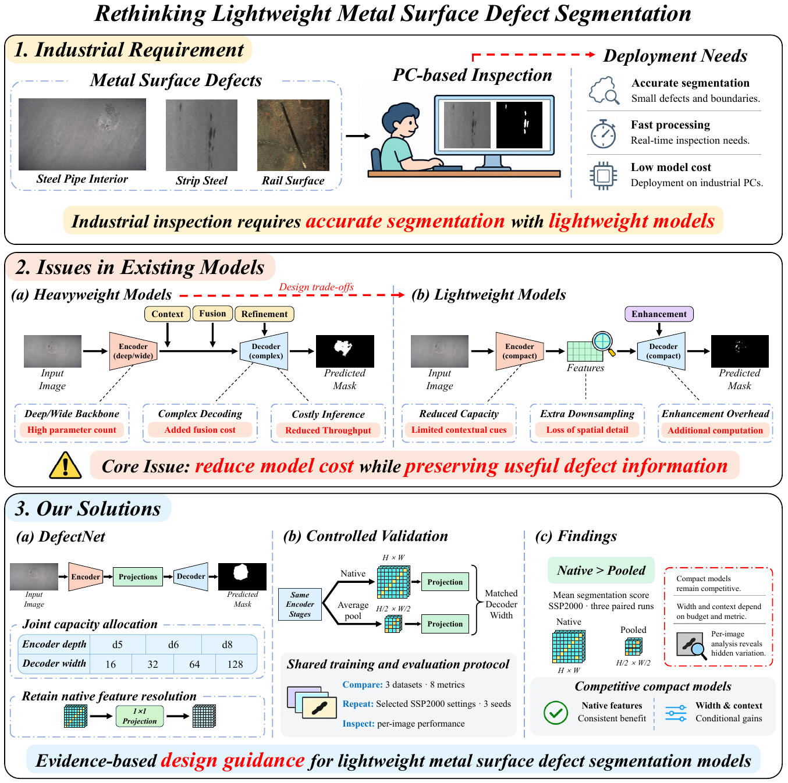
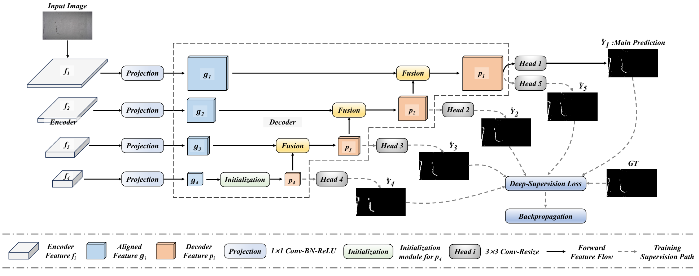

# LightDefect

**DefectNet for metal surface defect segmentation**

Project page for *Rethinking Lightweight Encoder–Decoder Design for Metal Surface Defect Segmentation*.
LightDefect is the project name; DefectNet is the model name used in the paper.
Publication details will be added when available.

## Overview

DefectNet is a compact encoder–decoder framework for studying how encoder capacity,
decoder width, and feature processing affect metal surface defect segmentation.
It combines a pretrained lightweight backbone with top-down multi-scale fusion
and retains the native spatial resolutions of the selected encoder features.

The study includes configuration comparisons on three datasets, repeated
native-versus-pooled comparisons on SSP2000, and per-image analysis.
On SSP2000, the d6-mc64 reference configuration achieves an Sα of **0.8296**
with **0.914M parameters** under the reported experimental settings.

## Motivation



## Model architecture



## Downloads

The source package and prediction maps are available in a shared Baidu Netdisk folder.
The source package contains model, training, inference and evaluation code,
dataset split lists, and usage instructions. Dataset images, ground-truth masks
and trained checkpoints are not included.

**Download:** [Baidu Netdisk shared folder](https://pan.baidu.com/s/15gnheM1rqGpzwJJkWBERNQ)  
**Extraction code:** `sxd2`

Select the required archive from the shared folder:

| Archive | Contents |
| --- | --- |
| `DefectNet.zip` | Source code, training and evaluation scripts, dataset split lists, and usage instructions |
| `DefectNet_d6_mc64_predictions.zip` | DefectNet d6-mc64 prediction maps for SSP2000, SD-saliency-900, and NRSD-MN |

## Released prediction maps

Only the **d6-mc64 reference configuration** is included in the prediction archive.
All files are original 8-bit grayscale PNG maps, with their original filenames
and resolutions preserved.

| Dataset | Test images | Configuration | Sα reported in the paper |
| --- | ---: | --- | ---: |
| SSP2000 | 600 | DefectNet d6-mc64 | 0.8296 |
| SD-saliency-900 | 270 | DefectNet d6-mc64 | 0.8924 |
| NRSD-MN | 1,231 | DefectNet d6-mc64 | 0.9548 |

These are the archived single-run predictions associated with Tables 1–3.
Figure 5 uses d6-mc32; the prediction archive does not represent that figure's
configuration or the repeated experiments in Table 9. Historical training seeds
are not inferred from the filenames. The archive contains a manifest and per-file
SHA-256 checksums. The displayed scores are paper-reported values.

## Usage

1. Download and extract the source package.
2. Follow its README to install dependencies and prepare the dataset directories.
3. Download and extract the prediction archive for saved-map evaluation.

Saved-map evaluation requires NumPy, Pillow and SciPy; it does not require model
weights or a GPU. Matching ground-truth masks and evaluation lists are required.
For example, from the extracted source-code directory:

```bash
python -m pip install -r requirements-eval.txt
python evaluate.py --pred-dir PATH/DefectNet_d6_mc64_predictions/SSP2000 --data-root PATH/SSP2000/Test --metrics-json metrics_ssp2000.json
```

Use the final evaluation scripts supplied in the source package when comparing
results with the manuscript. See the package documentation for preprocessing,
metric definitions and the scope of reproduction.

## License

The project source code and scripts are licensed under the **PolyForm
Noncommercial License 1.0.0**. See [LICENSE](LICENSE) for the complete terms.
This project page carries the same license text as the downloadable source package.

The license permits noncommercial purposes and the institutional uses expressly
listed in its terms. It allows modification and redistribution subject to its
conditions. Uses not covered by the license require separate permission from the
applicable rights holders. The full license controls over this brief summary.

The software license does not automatically license the paper figures,
prediction maps, original datasets, or other non-code materials. It grants no
additional rights in those materials. Third-party components retain their own
licenses; this license does not replace their terms.

